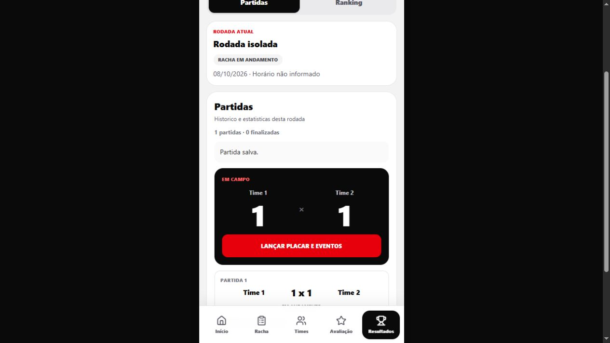
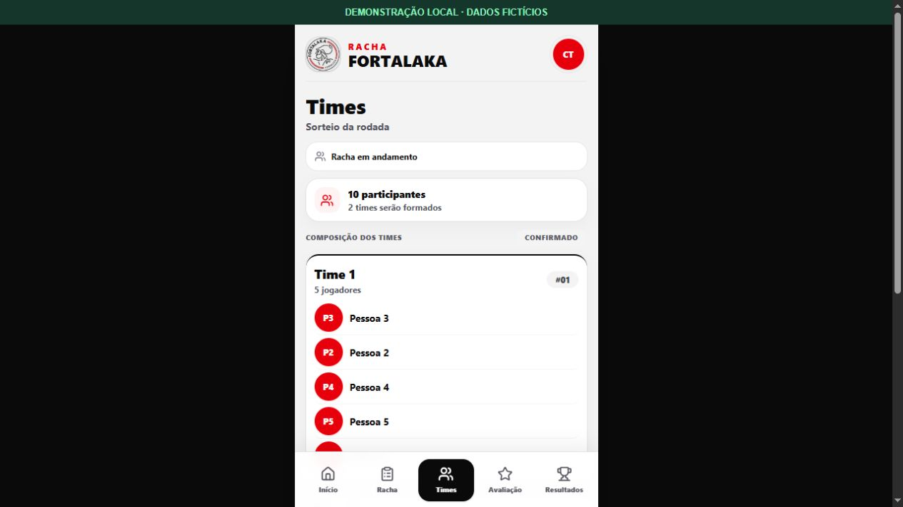
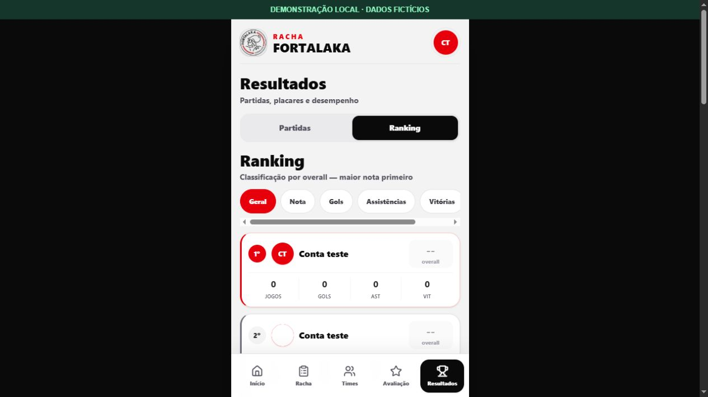

<p align="center"></p>

# Racha Fortalaka

Gestão de futebol amador: da inscrição na rodada ao sorteio dos times, resultados e avaliações dos jogadores.

**Next.js · React · TypeScript · Tailwind CSS · Supabase**

[**⚽ Acessar o aplicativo**](https://fortalaka-racha.vercel.app) · [Instalação](docs/guia-instalacao.md) · [Fluxo da rodada](docs/fluxo-principal.md) · [Mais projetos](https://github.com/igorcastro1010)

[](https://github.com/igorcastro1010/fortalaka-racha/actions/workflows/ci.yml)

## Funcionalidades em tela

Capturas de demonstração local com dados fictícios, preparadas em 22/10/2026. Não representam dados de produção. [Como foram produzidas](docs/capturas-demonstracao.md).

### Placar e partidas



### Times confirmados



### Ranking



## O que o projeto faz

- **Rodadas e inscrições:** data, horário, endereço e inscrição como jogador de linha ou goleiro.
- **Times:** sorteio e confirmação de composições, com tratamento separado dos goleiros.
- **Partidas e fila:** placares, gols, assistências, participação e histórico.
- **Resultados e ranking:** estatísticas derivadas de partidas finalizadas, sem edição direta dos totais no perfil.
- **Avaliações:** notas entre companheiros elegíveis e abertura controlada pelo organizador.
- **Permissões:** Supabase Auth, RLS e funções do banco para as operações administrativas.

## Começar localmente

Requer Node.js 24 e um projeto Supabase configurado. Instale as dependências e copie o modelo de ambiente:

```powershell
npm ci
Copy-Item .env.example .env.local
npm run dev
```

Preencha as duas variáveis de `.env.local` com a URL e a chave pública do seu projeto. Abra [localhost:3000](http://localhost:3000). O guia de [instalação](docs/guia-instalacao.md) explica banco, scripts e verificações.

## Documentação

| Tema | Guia |
| --- | --- |
| Ambiente e banco | [Instalação](docs/guia-instalacao.md) |
| Jornada do organizador e do jogador | [Fluxo principal](docs/fluxo-principal.md) |
| Estatísticas históricas | [Partidas e estatísticas](docs/partidas-estatisticas.md) |
| Encerramento da rodada | [Finalizar rodada](docs/finalizar-rodada.md) |
| Sorteio | [Instalação do sorteio](docs/instalacao-sorteio-times.md) |

**Banco de dados:** os scripts SQL precisam ser aplicados separadamente. A presença do código no GitHub e o deploy do frontend não confirmam a instalação das migrações no Supabase.

## Verificações automáticas

O workflow executa lint, testes existentes de ordenação do ranking e build. Esses testes não substituem as suítes SQL, os testes de navegação ou a validação do banco remoto. Clique no badge para consultar o resultado real da execução.
